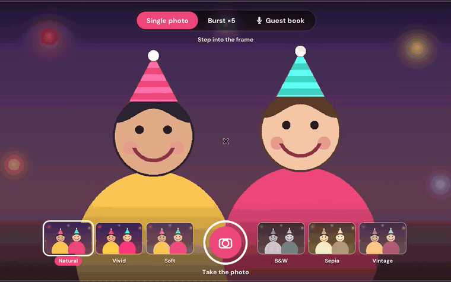
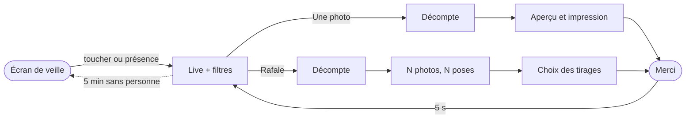
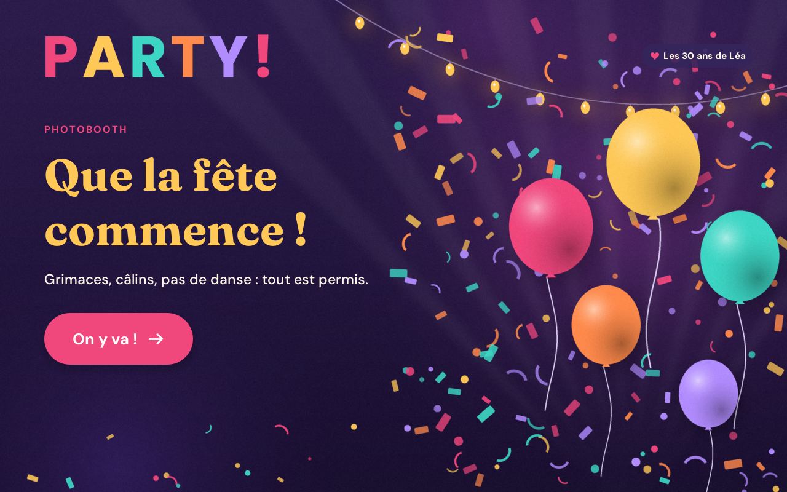
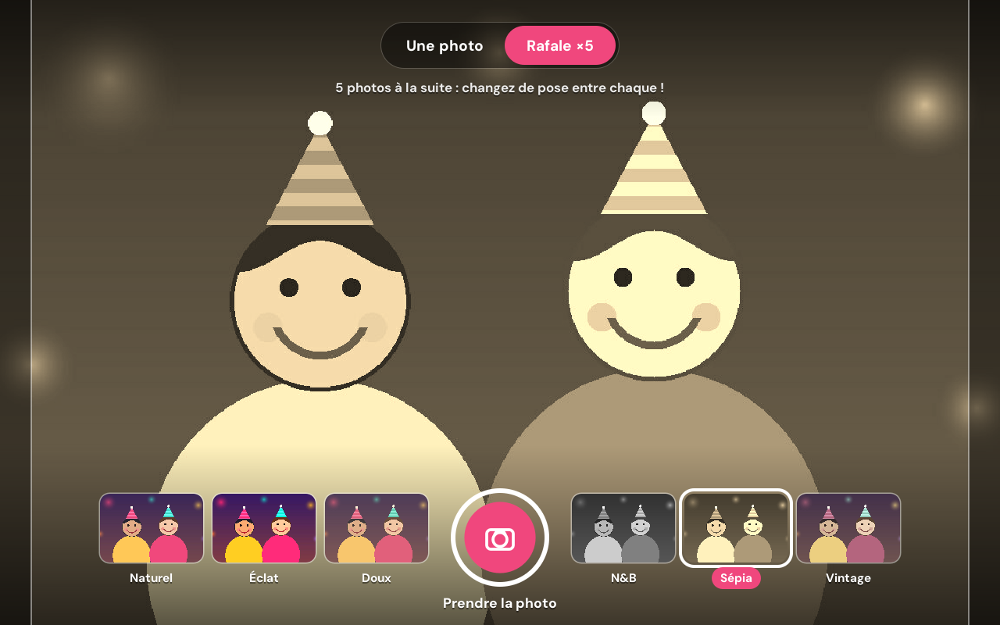
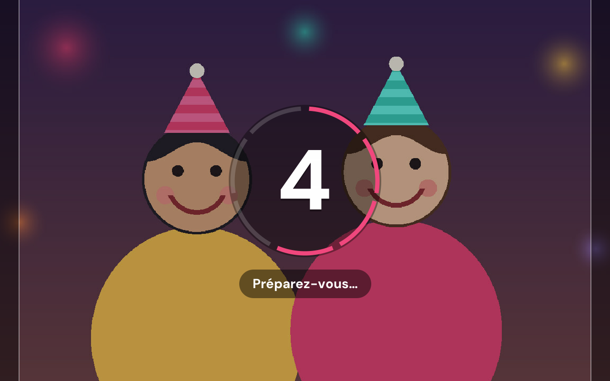
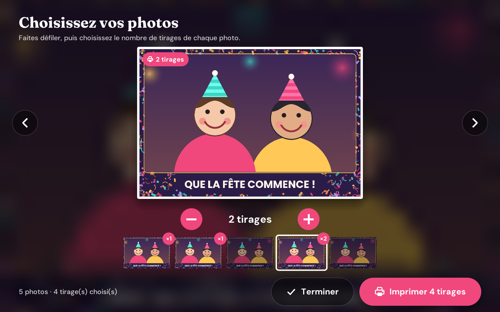
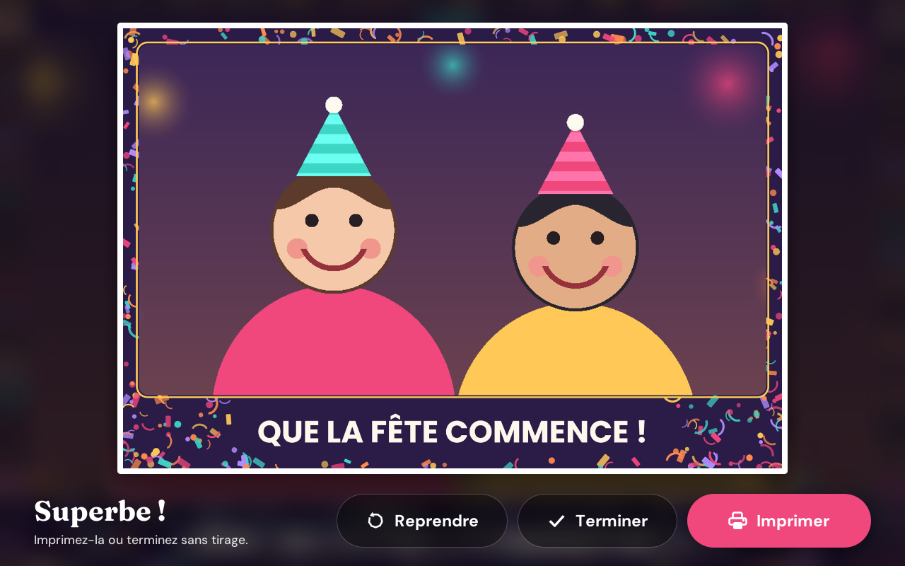
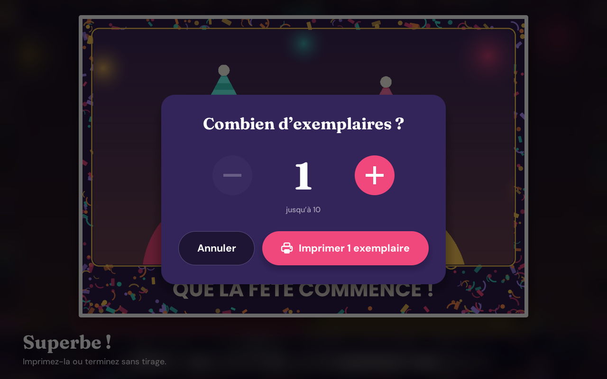
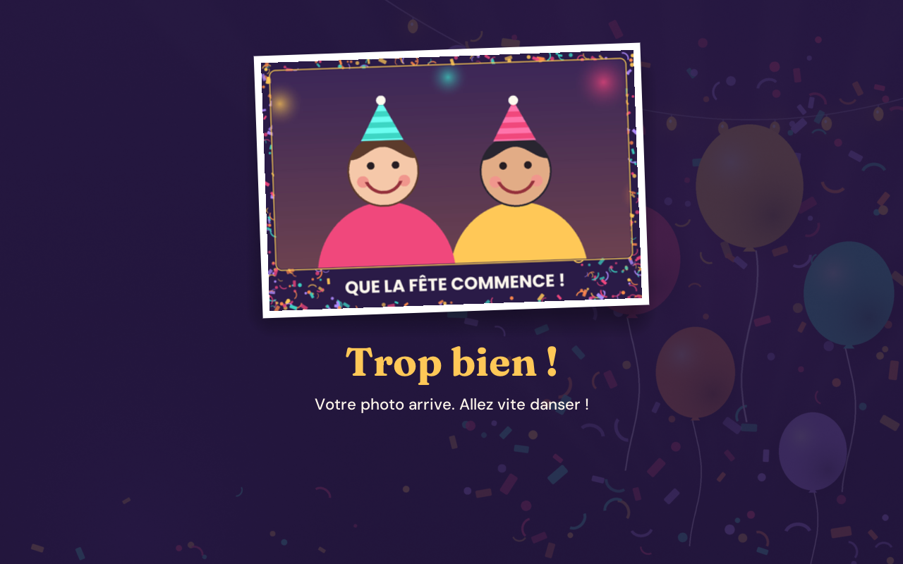
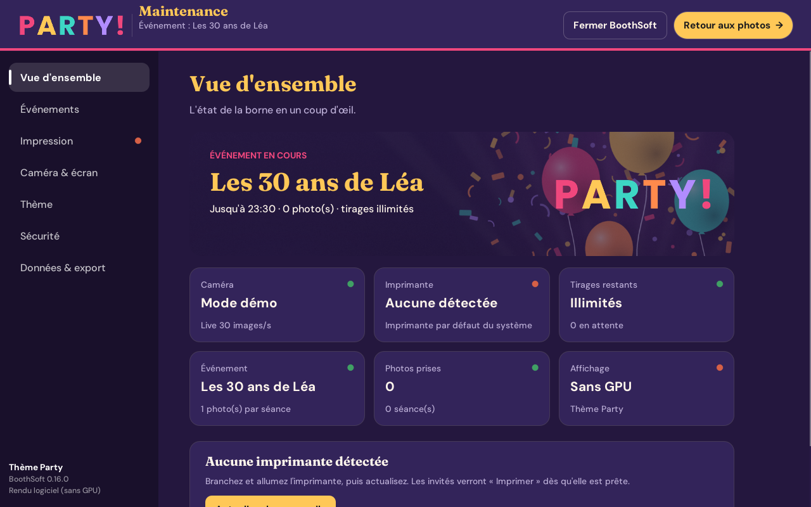

<div align="center">

# 📸 BoothSoft

### La borne photo libre qui travaille toute seule.

Les invités touchent l'écran, prennent la pose et repartent avec leur tirage 10×15.<br>
Sans cloud, sans abonnement, sans opérateur — sur un petit mini-PC.

<a href="LICENSE"></a>   <a href="CONTRIBUTING.md"></a>

    

     

<a href="https://github.com/Ryvexam/BoothSoft/actions/workflows/native.yml"></a> <a href="https://github.com/Ryvexam/BoothSoft/stargazers"></a> <a href="https://github.com/Ryvexam/BoothSoft/issues"></a> <a href="https://github.com/Ryvexam/BoothSoft/commits/main"></a>  

[English](README.md) · **Français**

[Fonctionnalités](#-fonctionnalités) ·
[Captures](#-captures-décran) ·
[Performances](#-performances) ·
[Démarrage rapide](#-démarrage-rapide) ·
[Feuille de route](#-état-du-projet-et-feuille-de-route) ·
[Contribuer](#-contribuer)

<br>



<sub>Enregistré avec le thème livré « Party » et la caméra simulée intégrée ·
<a href="docs/media/demo.mp4">vidéo complète (38 s)</a></sub>

</div>

---

> [!NOTE]
> L'interface est aujourd'hui en **français**. Un système de langues — anglais par
> défaut, français, espagnol et chinois — est prévu dans la
> [feuille de route](docs/specs/LANGUAGES.md).

## ✨ Pourquoi BoothSoft

Les logiciels de borne photo du marché sont complets, mais ils demandent un abonnement,
un compte et une machine confortable. BoothSoft part du besoin réel d'un loueur :
**une borne qui s'allume et travaille seule toute une soirée**.

| | | |
| :--- | :--- | :--- |
| 🔌 **Hors ligne**<br>Aucun compte, aucun cloud, aucun port ouvert, aucune télémétrie. | 🪶 **Poids plume**<br>0 % de processeur au repos, environ 140 Mo de mémoire, un exécutable de 12 Mo. | 👆 **Pensé pour le doigt**<br>Gros boutons, animations courtes au toucher, aucun clavier côté invités. |
| 🗓️ **Autonome**<br>Planning d'événements, veille et réveil automatiques, lancement au démarrage. | 🎨 **Personnalisable**<br>Couleurs, logo, écran d'accueil et textes dans un simple dossier. | 🦀 **100 % Rust**<br>Un seul exécutable natif. Ni moteur web, ni langage de script. |

## 🚀 Fonctionnalités

| | |
| --- | --- |
| **Live vidéo** | 30 images/s, en miroir, avec un guide montrant ce qui sera imprimé |
| **Filtres en direct** | 6 filtres (Naturel, Éclat, Doux, N&B, Sépia, Vintage), chacun en vignette vivante |
| **Modes de prise de vue** | *Une photo* ou *Rafale* (3 à 10 photos, une consigne de pose à chacune), au choix de l'invité |
| **Livre d'or vidéo** | En option : test du micro avec jauge en direct, puis message vidéo de 2 à 30 s avec le son pour les hôtes (AVI, sans réencodage) |
| **Choix des tirages** | Après une rafale, on fait défiler les photos au doigt et on choisit les tirages de chacune |
| **Cadre d'impression** | Un PNG posé sur la photo, format 10×15 ; la photo se place dans la zone transparente du cadre, détectée automatiquement |
| **Paysage et portrait** | Paysage, portrait ou au choix de l'invité, chacun avec son cadre ; tirage portrait tourné pour l'imprimante, jamais déformé |
| **Impression** | Imprimante par défaut du système, exemplaires par photo, quota par événement |
| **Événements** | Planning avec dates et horaires ; chaque événement a son dossier de photos et son quota |
| **Veille** | Écran d'accueil après quelques minutes ; réveil au toucher ou quand quelqu'un s'approche |
| **Thèmes** | Un dossier avec un `config.toml` et quelques PNG ; import par ZIP |
| **Maintenance** | Panneau protégé par code, entièrement tactile, aux couleurs du thème |
| **Mode borne** | Plein écran, lancement au démarrage de l'ordinateur |

### Le déroulé d'une séance



## 🖼️ Captures d'écran

Toutes les captures utilisent le thème livré, **Party**.

| Écran de veille | Live et filtres en direct |
| :---: | :---: |
|  |  |
| **Décompte** | **Après une rafale : choix des tirages** |
|  |  |
| **Aperçu du tirage** | **Nombre d'exemplaires** |
|  |  |
| **Remerciement** | **Maintenance** |
|  |  |

## ⚡ Performances

Mesuré sur une machine Linux à 2 cœurs **sans carte graphique** (rendu logiciel), avec
la caméra simulée. C'est le pire cas ; la méthode et les tableaux complets sont dans
[`docs/GUEST_UI.md`](docs/GUEST_UI.md).

| Situation | Processeur (1 cœur = 100 %) | Mémoire |
| --- | --- | --- |
| Au repos, n'importe quel écran | **0 %** | ~140 Mo |
| Veille avec détection de présence | ~1 % | ~140 Mo |
| Live 30 images/s, scène immobile | ~19 % | ~140 Mo |
| Live 30 images/s, scène animée | ~48 % | ~140 Mo |
| Rafale et choix des tirages | — | ~165 Mo en pointe |

Avec une puce graphique, le rendu quitte le processeur. Ces chiffres n'ont **pas encore**
été mesurés sur Windows ni sur du matériel de borne réel.

<details>
<summary><b>Comment ça reste aussi léger</b></summary>

- Un écran immobile ne se redessine jamais. Les animations sont courtes (≤ 250 ms), déclenchées par un toucher, et s'arrêtent seules.
- L'image de la caméra part directement dans une texture OpenGL ; filtre, miroir et recadrage se font dans un shader.
- Rien de lent sur le fil d'interface : décodage, encodage, disque et impression vivent dans des fils de travail.
- Quand rien ne bouge devant la caméra, les images ne sont pas redessinées.
- Les tampons d'image sont recyclés ; le redimensionnement utilise le SIMD.

</details>

## 🧰 Matériel

| Élément | Pris en charge aujourd'hui |
| --- | --- |
| Caméra | Webcams USB (Windows, macOS, Linux) |
| Imprimante | Toute imprimante installée sur le système ; pensé pour les imprimantes photo 10×15 à sublimation |
| Écran | Tactile recommandé ; souris et clavier acceptés |
| Ordinateur | Un mini-PC modeste suffit (type Intel Core i5, 8 Go de mémoire) |

Les reflex et hybrides ne sont pas encore pris en charge dans la version libre — voir
[État du projet](#-état-du-projet-et-feuille-de-route).

## 🏁 Démarrage rapide

Il faut [Rust](https://rustup.rs) (version stable).

```sh
git clone <adresse-du-dépôt> boothsoft
cd boothsoft

# Essayer tout de suite : sans caméra, dans une fenêtre
cargo run --release -- --demo --windowed

# Avec la caméra simulée (deux invités de dessin animé)
BOOTHSOFT_SYNTHETIC_CAMERA=guests cargo run --release -- --windowed

# En conditions réelles : plein écran, webcam, sous le gardien
cargo build --release && target/release/boothsoft-guard
```

<details>
<summary><b>Dépendances de compilation sous Linux</b></summary>

Installez les paquets de développement pour V4L2, X11 ou Wayland, et OpenGL. Sous Debian / Ubuntu :

```sh
sudo apt install build-essential pkg-config nasm cmake \
  libv4l-dev libx11-dev libxkbcommon-dev libwayland-dev libgl1-mesa-dev
```

La liste exacte dépend de la distribution ; l'erreur de compilation nomme la bibliothèque manquante.

</details>

| Option | Effet |
| --- | --- |
| `--demo` | Aucune caméra : une image de démonstration sert de photo |
| `--windowed` | Fenêtre au lieu du plein écran |
| `--theme NOM` | Force un thème installé |

### Ouvrir la maintenance

Touchez **5 fois rapidement le coin supérieur gauche du live** (ou `Ctrl+Maj+D`).
Au premier accès, vous choisissez un code à 6 chiffres. Vous y réglez le planning des
événements, l'imprimante, le nombre de tirages, la caméra, le thème et le démarrage.

## 🎨 Thèmes

Un thème est un dossier : un `config.toml` (nom, six couleurs, textes) et des images
PNG (logo, écran d'accueil, cadre). BoothSoft livre un thème, **Party**
([`themes/default`](themes/default)). Pour créer le vôtre, copiez ce dossier,
modifiez-le, puis importez-le en ZIP depuis la maintenance — ou déposez-le dans le
dossier de données de l'application (`BoothSoft/themes/`). Votre marque reste chez vous.

Le format est décrit dans [`docs/ARCHITECTURE.md`](docs/ARCHITECTURE.md).

## 🗂️ Où vont les photos

Tout reste sur l'ordinateur, dans le dossier de données de l'utilisateur :

```
BoothSoft/
└── sessions/
    └── 2026-11-14-mariage-lea-hugo/      un dossier par événement
        └── 20261114-203512-…/            un dossier par séance
            ├── photo-01.jpg              l'original
            └── photo-01-cadre.jpg        la version imprimée, avec le cadre
```

## 🧭 État du projet et feuille de route

BoothSoft est jeune (version 0.16). Avant de compter dessus pour un vrai événement :

> [!WARNING]
> **Windows** est la cible principale, mais le développement et les mesures se font sur
> macOS et Linux. La version Windows doit encore être validée sur du matériel de borne.

- [x] Live, filtres en direct, modes photo et rafale
- [x] Impression avec exemplaires et quota par événement
- [x] Planning d'événements, photos rangées par événement
- [x] Veille, réveil à l'approche, lancement au démarrage
- [x] Maintenance tactile aux couleurs du thème
- [x] Gardien : relance BoothSoft après un plantage ou un gel, mode sans échec, redémarrage nocturne
- [x] Journal quotidien pour comprendre une panne après coup
- [ ] Auto-réparation : reconnexion de la caméra, file d'impression gérée seule
- [ ] Un cadre par événement, avec une fabrique de cadres intégrée
- [ ] Éditeur de thèmes intégré et clavier tactile
- [x] Tirages en portrait avec leur propre cadre
- [x] Livre d'or vidéo (en option) : un message de 30 s avec le son pour les hôtes
- [ ] Langues : anglais (par défaut), français, espagnol, chinois
- [ ] Suivi automatique de la file d'impression (aujourd'hui un tirage envoyé reste « à vérifier » jusqu'à confirmation en maintenance)
- [ ] Reflex et hybrides — dépend de kits de fabricants non redistribuables ; le code
      offrira un point d'extension pour l'ajouter chez soi
      ([`docs/EXTENSIONS.md`](docs/EXTENSIONS.md))

La liste complète et classée est dans la [feuille de route](docs/ROADMAP.md).

## 📚 Documentation

| Document | Contenu |
| --- | --- |
| [`docs/ARCHITECTURE.md`](docs/ARCHITECTURE.md) | Fils d'exécution, écrans, formats de données, chaîne photo → tirage |
| [`docs/GUEST_UI.md`](docs/GUEST_UI.md) | Parcours invité, règles de rendu, toutes les mesures |
| [`docs/ROADMAP.md`](docs/ROADMAP.md) | Chantiers à venir, classés |
| [`docs/specs/`](docs/specs) | Spécifications détaillées des prochains chantiers |
| [`docs/EXTENSIONS.md`](docs/EXTENSIONS.md) | Ajouter une caméra ou un thème privés sans modifier ce dépôt |
| [`AGENTS.md`](AGENTS.md) | Règles du projet, pour les contributeurs humains et les agents de code |

## 🤝 Contribuer

Les contributions sont les bienvenues — lisez d'abord [`CONTRIBUTING.md`](CONTRIBUTING.md).
En deux mots : tout en Rust, 0 % de processeur au repos, rien de lent sur le fil
d'interface, et chaque changement visible est mesuré.

Un problème de sécurité ? Voir [`SECURITY.md`](SECURITY.md).

## 📄 Licence

BoothSoft est distribué sous licence [Common Public Attribution License 1.0](LICENSE)
(CPAL-1.0, approuvée par l'OSI). Vous pouvez l'utiliser, le modifier, le vendre et le
redistribuer, à deux conditions :

- **Crédit visible.** Toute copie, tout fork ou tout produit construit sur BoothSoft
  affiche « BoothSoft, créé par Dôm'Booth — dombooth.com » à l'écran à chaque
  lancement, comme l'original (annexe B de [`LICENSE`](LICENSE)).
- **Partage des modifications.** Les fichiers de BoothSoft modifiés que vous distribuez,
  ou que vous faites tourner pour d'autres, restent sous CPAL-1.0 avec leur source
  disponible. Votre code séparé (module caméra, thème de marque) peut rester privé.

Les polices embarquées (Fraunces, DM Sans) sont sous licence SIL Open Font License ;
voir [`NOTICE`](NOTICE).

## 💚 Crédits

Créé par [Dôm'Booth](https://dombooth.com). Construit avec
[egui](https://github.com/emilk/egui), [nokhwa](https://github.com/l1npengtul/nokhwa),
[mozjpeg](https://github.com/mozilla/mozjpeg) et
[fast_image_resize](https://github.com/Cykooz/fast_image_resize).

<div align="center"><sub>Si BoothSoft fait tourner vos événements, une ⭐ aide les autres à le trouver.</sub></div>
