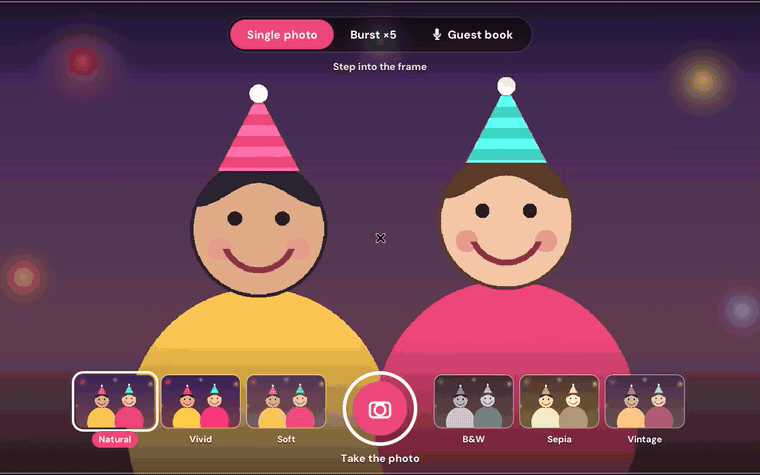
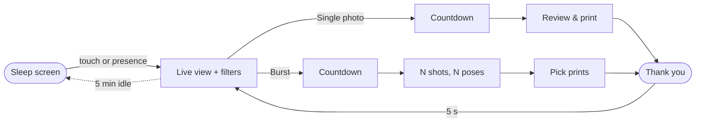
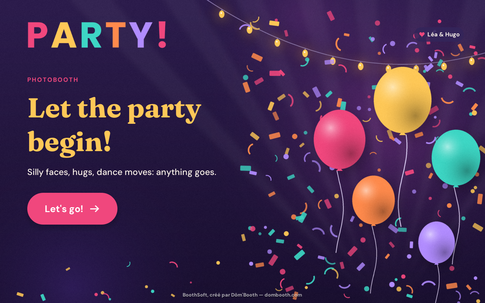
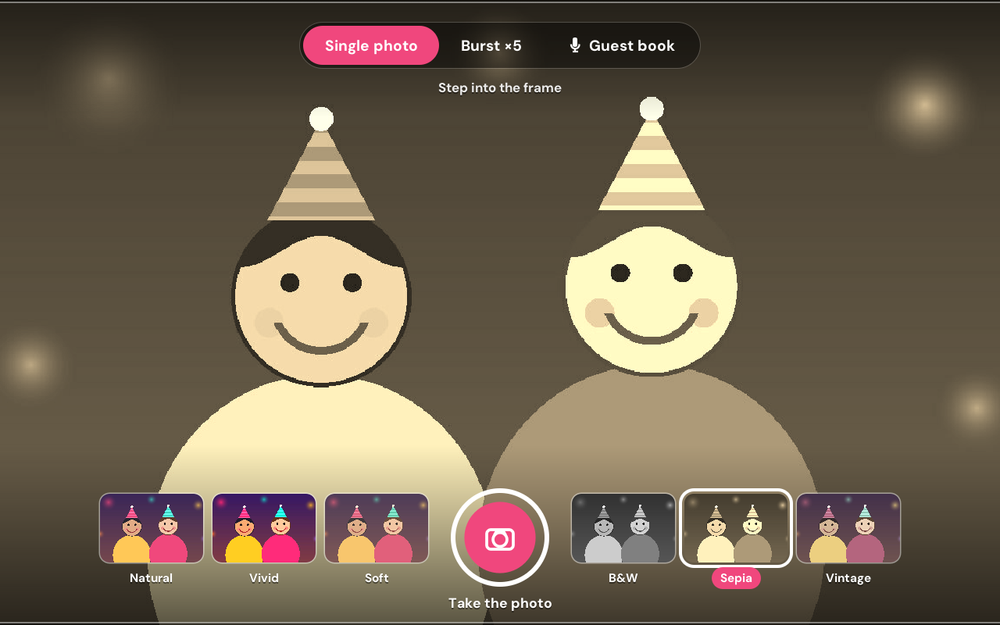
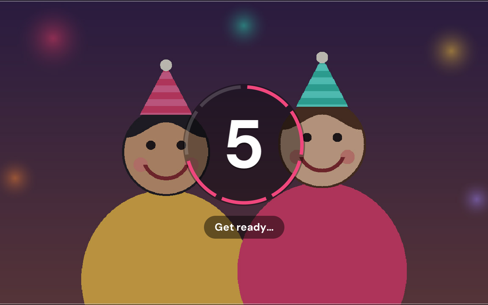
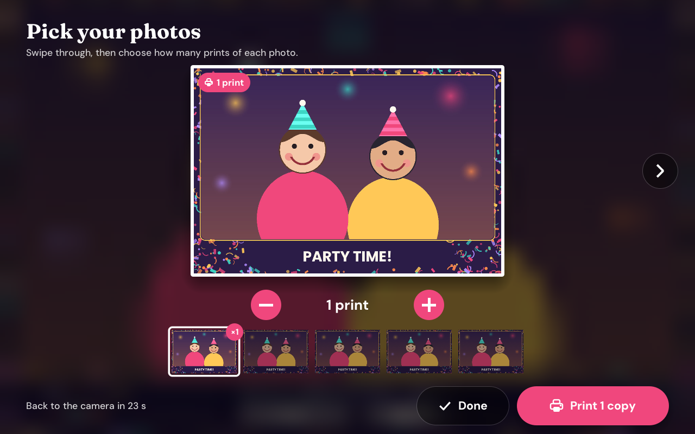
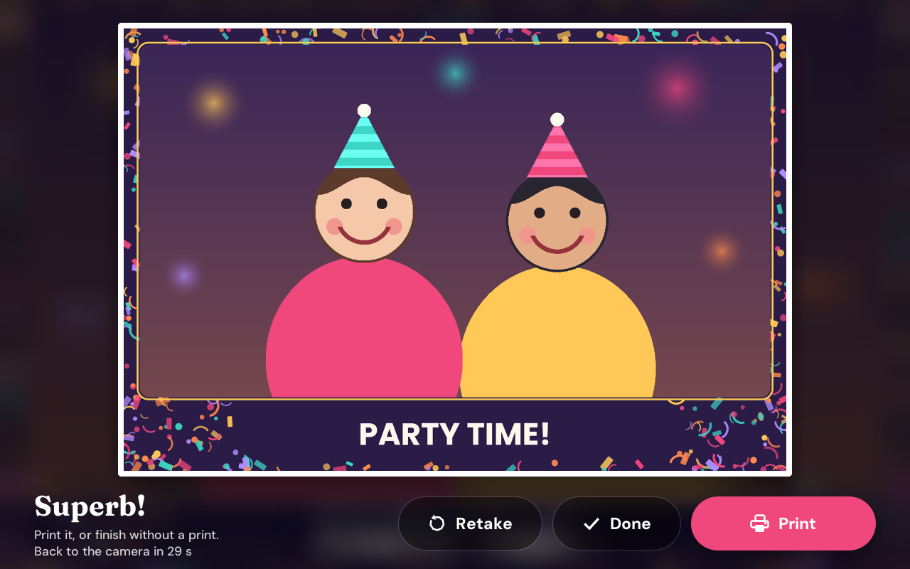
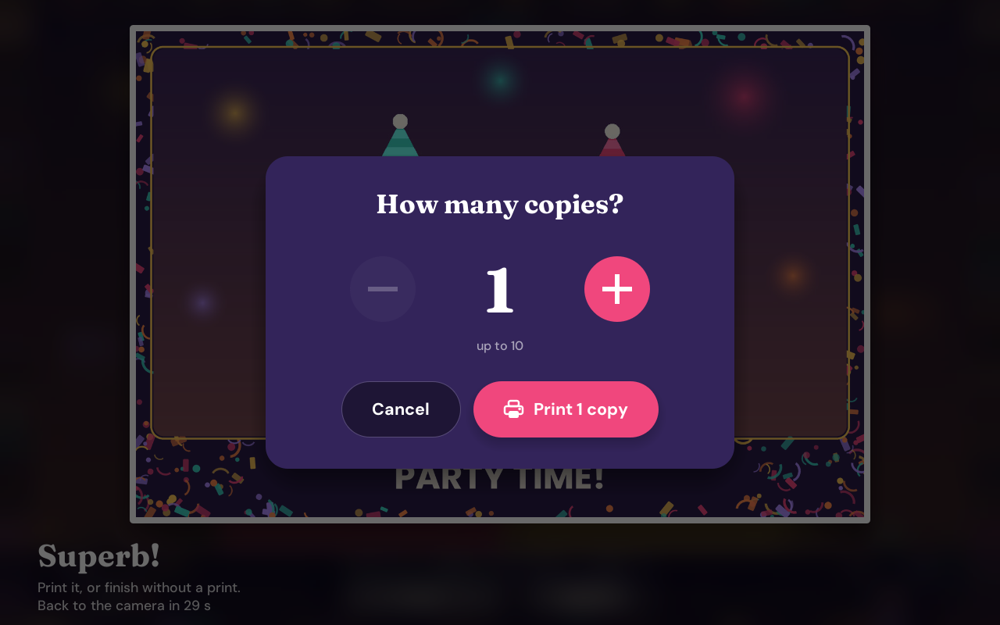
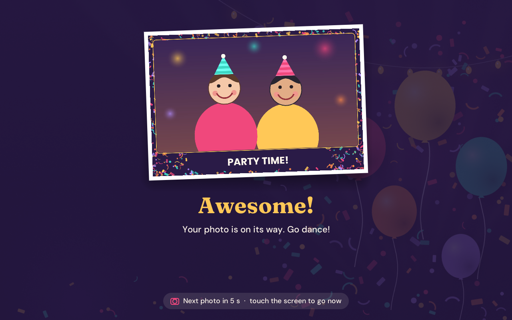
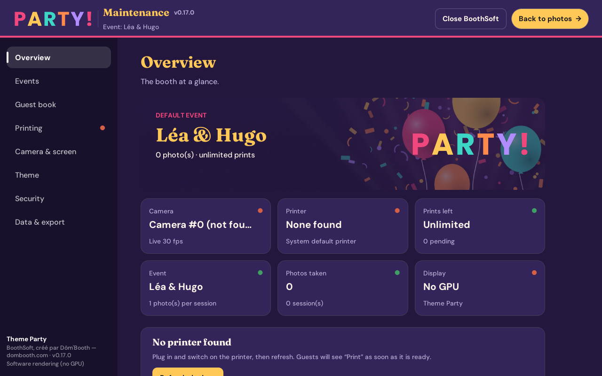

<div align="center">

# 📸 BoothSoft

### The open-source photo booth that runs itself.

Guests tap the screen, strike a pose and walk away with a 4×6 print.<br>
No cloud, no subscription, no operator — on a modest mini-PC.

<a href="LICENSE"></a>   <a href="CONTRIBUTING.md"></a>

    

     

<a href="https://github.com/Ryvexam/BoothSoft/actions/workflows/native.yml"></a> <a href="https://github.com/Ryvexam/BoothSoft/stargazers"></a> <a href="https://github.com/Ryvexam/BoothSoft/issues"></a> <a href="https://github.com/Ryvexam/BoothSoft/commits/main"></a>  

**English** · [Français](README.fr.md)

[Features](#-features) ·
[Screenshots](#-screenshots) ·
[Performance](#-performance) ·
[Quick start](#-quick-start) ·
[Roadmap](#-project-status--roadmap) ·
[Contributing](#-contributing)

<br>



<sub>Recorded with the bundled “Party” theme and the built-in simulated camera ·
<a href="docs/media/demo.mp4">full video (36 s)</a></sub>

</div>

---

> [!NOTE]
> The interface speaks **English** and **French**. It follows the computer's language
> (English when the computer uses another one) and can be fixed in maintenance.
> Spanish and Chinese are planned
> ([spec](docs/specs/LANGUAGES.md)).

## ✨ Why BoothSoft

Commercial photo booth suites are feature-rich, but they expect a subscription, an
account and a comfortable machine. BoothSoft starts from what a rental business
actually needs: **a booth that powers on and works alone for a whole evening**.

| | | |
| :--- | :--- | :--- |
| 🔌 **Offline by design**<br>No account, no cloud, no open port, no telemetry. | 🪶 **Featherweight**<br>0 % CPU when idle, about 140 MB of RAM, a 12 MB executable. | 👆 **Built for fingers**<br>Large targets, short touch-driven animations, no keyboard for guests. |
| 🗓️ **Runs itself**<br>Event schedule, sleep and wake on presence, start with the computer. | 🎨 **Themeable**<br>Colours, logo, welcome screen and wording live in a plain folder. | 🦀 **100 % Rust**<br>One native binary. No web engine, no scripting runtime. |

## 🚀 Features

| | |
| --- | --- |
| **Live view** | 30 fps, mirrored, with a guide showing exactly what will be printed |
| **Real-time filters** | 6 filters (Natural, Vivid, Soft, B&W, Sepia, Vintage), each shown as a live thumbnail |
| **Shooting modes** | *Single photo* or *Burst* (3 to 10 shots, a new pose prompt for each one) — the guest chooses |
| **Video guest book** | Optional: mic check with a live level meter, then a 2–30 s video message with sound for the hosts (AVI, no re-encoding) |
| **Print picker** | After a burst, swipe through the shots and set the number of prints for each |
| **Print frame** | A PNG laid over the photo, 4×6 in (10×15 cm); the photo fits the frame's transparent window, found automatically |
| **Landscape & portrait** | Landscape, portrait or the guest's choice, each with its own frame; portrait prints turned for the printer, never stretched |
| **Printing** | System default printer, copies per photo, print quota per event |
| **Events** | Schedule with dates and hours; each event gets its own photo folder and quota |
| **Sleep mode** | Welcome screen after a few idle minutes; wakes on touch or when someone walks up |
| **Themes** | A folder with a `config.toml` and a few PNGs; import as a ZIP |
| **Maintenance** | PIN-protected, fully touch-driven panel that wears the theme colours |
| **Kiosk mode** | Full screen, optional start with the computer |

### How a session goes



## 🖼️ Screenshots

All screenshots use the bundled theme, **Party**.

| Sleep screen | Live view and real-time filters |
| :---: | :---: |
|  |  |
| **Countdown** | **After a burst: pick your prints** |
|  |  |
| **Print review** | **Number of copies** |
|  |  |
| **Thank you** | **Maintenance** |
|  |  |

## ⚡ Performance

Measured on a 2-core Linux machine **without a GPU** (software rendering), with the
simulated camera. This is the worst case; the method and the full tables are in
[`docs/GUEST_UI.md`](docs/GUEST_UI.md).

| Situation | CPU (one core = 100 %) | Memory |
| --- | --- | --- |
| Idle, any screen | **0 %** | ~140 MB |
| Sleep with presence detection | ~1 % | ~140 MB |
| Live view 30 fps, still scene | ~19 % | ~140 MB |
| Live view 30 fps, moving scene | ~48 % | ~140 MB |
| Burst and print picker | — | ~165 MB peak |

With a GPU, rendering leaves the CPU. These figures have **not yet** been measured on
Windows or on real booth hardware.

<details>
<summary><b>How it stays that light</b></summary>

- Static screens never repaint. Animations are short (≤ 250 ms), touch-driven, and stop on their own.
- The camera frame goes straight into an OpenGL texture; filter, mirror and crop run in a shader.
- Nothing slow ever runs on the UI thread: decoding, encoding, disk and printing live on worker threads.
- A motion gate skips frames when nothing moves in front of the camera.
- Image buffers are recycled; resizing uses SIMD.

</details>

## 🧰 Hardware

| Component | Supported today |
| --- | --- |
| Camera | USB webcams (Windows, macOS, Linux) |
| Printer | Any printer installed on the system; designed for 4×6 dye-sublimation photo printers |
| Screen | Touch screen recommended; mouse and keyboard also work |
| Computer | A modest mini-PC is enough (Intel Core i5 class, 8 GB of RAM) |

DSLR and mirrorless cameras are not supported in the open-source build yet — see
[Project status](#-project-status--roadmap).

## 🏁 Quick start

You need [Rust](https://rustup.rs) (stable).

```sh
git clone <repository-url> boothsoft
cd boothsoft

# Try it right now: no camera, in a window
cargo run --release -- --demo --windowed

# With the simulated camera (two cartoon guests)
BOOTHSOFT_SYNTHETIC_CAMERA=guests cargo run --release -- --windowed

# For real: full screen, webcam, under the watchdog
cargo build --release && target/release/boothsoft-guard
```

<details>
<summary><b>Linux build dependencies</b></summary>

Install the development packages for V4L2, X11 or Wayland, and OpenGL. On Debian / Ubuntu:

```sh
sudo apt install build-essential pkg-config nasm cmake \
  libv4l-dev libx11-dev libxkbcommon-dev libwayland-dev libgl1-mesa-dev
```

The exact list depends on your distribution; the build error names the missing library.

</details>

| Option | Effect |
| --- | --- |
| `--demo` | No camera: a demonstration image is used as the photo |
| `--windowed` | A window instead of full screen |
| `--theme NAME` | Force an installed theme |

### Opening the maintenance panel

Tap the **top-left corner of the live view 5 times quickly** (or press `Ctrl+Shift+D`).
On first access you choose a 6-digit code. From there you set the event schedule, the
printer, the number of prints, the camera, the theme and start-up behaviour.

## 🎨 Themes

A theme is a folder: a `config.toml` (name, six colours, wording) and PNG images (logo,
welcome artwork, print frame). BoothSoft ships one theme, **Party**
([`themes/default`](themes/default)). To make your own, copy that folder, edit it, then
import it as a ZIP from the maintenance panel — or drop it in the application data
folder (`BoothSoft/themes/`). Your brand stays on your machine.

The format is described in [`docs/ARCHITECTURE.md`](docs/ARCHITECTURE.md).

## 🗂️ Where the photos go

Everything stays on the computer, in the user's data folder:

```
BoothSoft/
└── sessions/
    └── 2026-11-14-mariage-lea-hugo/      one folder per event
        └── 20261114-203512-…/            one folder per session
            ├── photo-01.jpg              the original
            └── photo-01-cadre.jpg        the printed version, with the frame
```

## 🧭 Project status & roadmap

BoothSoft is young (version 0.16). Before you rely on it for a real event:

> [!WARNING]
> **Windows** is the main target, but development and measurements happen on macOS and
> Linux. The Windows build still has to be validated on real booth hardware.

- [x] Live view, real-time filters, single photo and burst modes
- [x] Printing with copies and a per-event quota
- [x] Event schedule, per-event photo folders
- [x] Sleep mode, wake on presence, start with the computer
- [x] Themed, touch-first maintenance panel
- [x] Watchdog: restarts BoothSoft after a crash or a freeze, safe mode, nightly restart
- [x] Daily log files for after-the-fact diagnosis
- [ ] Self-healing: camera reconnection, self-managed print queue
- [ ] One print frame per event, with a built-in frame maker
- [ ] Built-in theme editor and on-screen keyboard
- [x] Portrait prints with their own frame
- [x] Video guest book (optional): a 30-second message with sound for the hosts
- [x] Languages: English (default) and French, following the computer's language
- [ ] More languages: Spanish, Chinese
- [ ] Automatic print-queue tracking (today a sent print stays “to check” until confirmed in maintenance)
- [ ] DSLR / mirrorless support — relies on manufacturer SDKs that cannot be redistributed;
      the code will expose an extension point so you can add it at home
      ([`docs/EXTENSIONS.md`](docs/EXTENSIONS.md))

The full, prioritised list is in the [roadmap](docs/ROADMAP.md).

## 📚 Documentation

| Document | What it covers |
| --- | --- |
| [`docs/ARCHITECTURE.md`](docs/ARCHITECTURE.md) | Threads, screens, data formats, the photo → print pipeline |
| [`docs/GUEST_UI.md`](docs/GUEST_UI.md) | Guest journey, rendering rules, every measurement |
| [`docs/ROADMAP.md`](docs/ROADMAP.md) | Upcoming work, prioritised |
| [`docs/specs/`](docs/specs) | Detailed specifications for the next milestones |
| [`docs/EXTENSIONS.md`](docs/EXTENSIONS.md) | Adding a private camera backend or theme without touching this repository |
| [`AGENTS.md`](AGENTS.md) | Project rules, for human contributors and coding agents |

Most documents are written in French for now.

## 🤝 Contributing

Contributions are welcome — read [`CONTRIBUTING.md`](CONTRIBUTING.md) first. In short:
everything in Rust, 0 % CPU when idle, nothing slow on the UI thread, and every visible
change comes with a measurement.

Found a security issue? See [`SECURITY.md`](SECURITY.md).

## 📄 License

BoothSoft is released under the [Common Public Attribution License 1.0](LICENSE)
(CPAL-1.0, OSI-approved). You may use, modify, sell and redistribute it, on two
conditions:

- **Visible credit.** Every copy, fork or product built on BoothSoft must show
  « BoothSoft, créé par Dôm'Booth — dombooth.com » on screen at each launch, as the
  original does (Exhibit B of [`LICENSE`](LICENSE)).
- **Share your changes.** Modified BoothSoft files you distribute, or run for others,
  stay under CPAL-1.0 with their source available. Your own separate code (a camera
  plug-in, a brand theme) can stay private.

The embedded fonts (Fraunces, DM Sans) are under the SIL Open Font License; see
[`NOTICE`](NOTICE).

## 💚 Credits

Created by [Dôm'Booth](https://dombooth.com). Built with
[egui](https://github.com/emilk/egui), [nokhwa](https://github.com/l1npengtul/nokhwa),
[mozjpeg](https://github.com/mozilla/mozjpeg) and
[fast_image_resize](https://github.com/Cykooz/fast_image_resize).

<div align="center"><sub>If BoothSoft powers your events, a ⭐ helps others find it.</sub></div>
